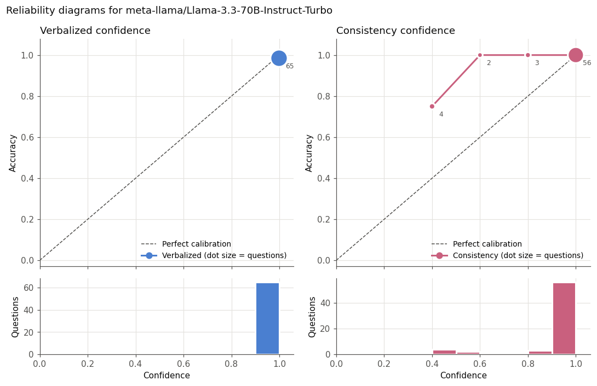

# Do Language Models Know When They Are Wrong?
### Calibration of LLM confidence on introductory statistics questions

When a language model says it is 90% sure, is it right 90% of the time? This project measures that gap on 65 multiple-choice questions in probability and statistics, the material I teach in introductory courses. It compares two ways of getting a confidence number from a model.

* **Verbalized confidence.** The model states a probability, from 0 to 100, that its answer is correct.
* **Sampling consistency.** The model answers the same question several more times at a higher temperature, and confidence is the share of those answers that agree with its main answer.

Calibration matters for safety and oversight. If people are going to rely on models in areas where they cannot check every answer themselves, the model's stated confidence needs to mean something. A model that is confidently wrong is harder to supervise than one that signals its own uncertainty.

## Research questions

1. Is the model's stated confidence calibrated, or is it systematically overconfident?
2. Does sampling consistency track correctness better than the confidence the model states?
3. Does the gap between confidence and accuracy grow as questions get harder?

## Method

**Questions.** 65 four-option multiple-choice questions written for this project (20 easy, 22 medium, 23 hard) across 15 topics, including conditional probability, distributions, expected value, hypothesis testing, and regression. Many wrong options are the mistakes students actually make, such as using the independence formula for mutually exclusive events or ignoring the base rate in a Bayes problem. Answer positions are shuffled with a fixed seed, so the correct letter is spread evenly across A to D. Every numeric answer key is verified by `scripts/verify_answers.py`, which recomputes each value exactly or by simulation and checks that no wrong option is equally close. The questions were drafted with help from an AI assistant and checked by me.

**Elicitation.** For each question the model answers once at temperature 0, which gives its main answer and stated confidence, and 5 more times at temperature 0.7. The prompt asks for brief reasoning followed by an answer letter and a confidence from 0 to 100.

**Metrics.**

| Metric | What it measures |
|---|---|
| Accuracy | Share of main answers that are correct |
| Overconfidence | Mean confidence minus accuracy |
| Brier score | Mean squared error of the confidence (lower is better) |
| Expected calibration error (ECE) | Average gap between confidence and accuracy across 10 bins, weighted by bin size |
| AUROC | Probability that a correct answer got higher confidence than a wrong one (0.5 means no signal) |

All metrics come with 95% bootstrap intervals, resampling questions.

## Results

> **To do.** Fill in after running the experiment. The numbers below are placeholders.

| Model | Method | Accuracy | Overconfidence | Brier | ECE | AUROC |
|---|---|---|---|---|---|---|
| Llama 3.3 70B | Verbalized | | | | | |
| Llama 3.3 70B | Consistency | | | | | |



**Findings.** *(Two to four sentences answering the research questions above, in your own words.)*

## Limitations

* **Small sample.** 65 questions give wide intervals, so small differences between methods may not be meaningful.
* **Multiple choice.** With four options, a blind guess is right 25% of the time, and the options themselves can hint at the answer.
* **Familiar puzzles.** Some hard questions, such as the Monty Hall and boy born on Tuesday problems, are well known and likely appear in training data. Accuracy on them may reflect memory rather than reasoning.
* **Coarse consistency scores.** With 5 samples, consistency can only take six values (0, 0.2, 0.4, 0.6, 0.8, 1).
* **One prompt.** Stated confidence is known to be sensitive to prompt wording, and only one wording is tested here.
* **Subjective difficulty.** Difficulty labels were assigned by me before any model was run.

## Running it

Requires Python 3.9 or later and a [Together AI](https://www.together.ai/) API key.

```
pip install -r requirements.txt
cp .env.example .env            # then paste your key into .env
python -m pytest                # unit tests for the metrics and answer parsing
python scripts/verify_answers.py
python run_experiment.py --dry-run      # free test with a simulated model
python run_experiment.py --limit 5      # quick real test on 5 questions
python run_experiment.py                # full run, 390 API calls
jupyter notebook analysis.ipynb
```

The full run with the default model (`meta-llama/Llama-3.3-70B-Instruct-Turbo`) uses roughly 250,000 tokens. To compare another model, pass `--model` with any name from `python run_experiment.py --list-models`. Each model's responses go to their own file in `results/raw/`, and the notebook compares every model it finds there. Runs can be interrupted and resumed, because already saved responses are skipped.

## Repository layout

```
data/questions.jsonl        the question set (correct answer listed first, shuffled at run time)
calibration/prompts.py      prompt construction and answer parsing
calibration/models.py       Together AI client and a simulated model for dry runs
calibration/metrics.py      Brier score, ECE, AUROC, reliability tables, bootstrap intervals
run_experiment.py           collects model responses
analysis.ipynb              metrics, reliability diagrams, and error analysis
scripts/verify_answers.py   independent check of every numeric answer key
tests/                      unit tests
results/raw/                saved model responses, one JSON Lines file per model
```

## Possible extensions

* Compare a small and a large model to see whether calibration improves with scale.
* Use token log probabilities as a third confidence measure.
* Test several prompt wordings to measure how sensitive stated confidence is.
* Replace multiple choice with free-response questions graded against the answer key.
